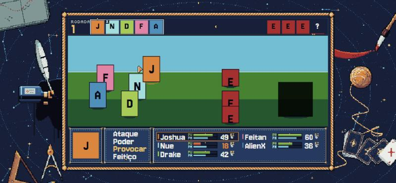
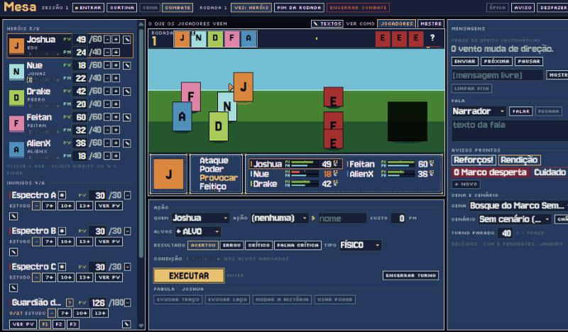
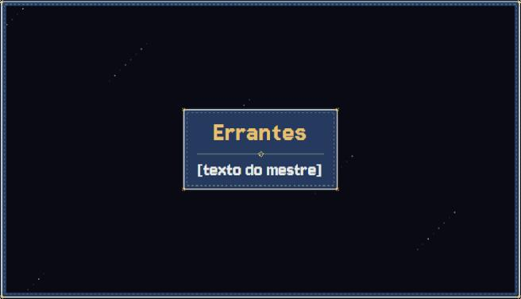

# aberwyn-vtt

Mesa virtual (VTT) com tela no estilo JRPG clássico e pixel art, feita para a campanha **Errantes**.
O mestre controla tudo numa **mesa** no próprio computador; cada jogador abre o **palco** no navegador e assiste.

> Projeto em construção. **Palco online:** https://chicletie.github.io/aberwyn-vtt/palco.html (com `?sala=CÓDIGO`, que a mesa gera).



| A mesa do mestre | A cortina (antes da sessão) |
|---|---|
|  |  |

## Para os jogadores

1. Abra o link que o mestre mandou (ou o palco e digite o **código da sala**).
2. **Deite o celular.**
3. Instale como app, para abrir em tela cheia e sem digitar o código de novo:
   - **Android (Chrome):** menu ⋮ → **Instalar app** (ou **Adicionar à tela inicial**).
   - **iPhone (Safari):** compartilhar → **Adicionar à Tela de Início**.

## Documentação

- [docs/DADOS.md](docs/DADOS.md): os arquivos que o mestre edita à mão e onde pôr cada PNG de arte.
- [docs/ONLINE.md](docs/ONLINE.md): como o modo online foi configurado (Firebase e GitHub Pages).
- [docs/ENSAIO.md](docs/ENSAIO.md): roteiro de ensaio antes de jogar.
- [docs/TOUR.md](docs/TOUR.md): ordem de leitura do código, com perguntas para estudar.
- [docs/DECISOES.md](docs/DECISOES.md) e [docs/GLOSSARIO.md](docs/GLOSSARIO.md): por que cada coisa foi feita assim, e o significado das palavras técnicas.

## Avisos

- **Não afiliado.** Este é um projeto independente de fã. Não é afiliado, patrocinado nem endossado pela Need Games nem pela Rooster Games.
- **Requer o livro básico.** Para jogar, é preciso o livro básico de *Fabula Ultima*. Este app não traz regras nem textos do livro; só mostra na tela os números que o mestre digita.
- **Licença de terceiros.** Publicado sob a [Fabula Ultima Third-Party Tabletop License 1.0](https://need.games/fabula-ultima).
- **Feito com ajuda de IA.** O código deste projeto foi escrito com a ajuda de uma IA (Claude, da Anthropic), sob direção e revisão do autor.

## Como rodar no computador

Precisa ter o [Node.js](https://nodejs.org) instalado. Na pasta do projeto:

```
npm install
npm run dev
```

O navegador abre a **mesa** (`http://localhost:5173/`). O **palco** (a tela dos jogadores) abre pelo link "ABRIR PALCO ↗" no canto. O botão **?** da mesa mostra os atalhos e o salvamento em arquivo. Os arquivos que o mestre edita à mão estão explicados em [`docs/DADOS.md`](docs/DADOS.md).

## Créditos

- Fontes **Jersey 10** e **Jersey 15** (The Soft Type Project Authors), licença SIL Open Font License 1.1. As versões deste projeto ("Jersey 10 PF" e "Jersey 15 PF") têm o til de ã/õ redesenhado.
- Fonte **Silkscreen** (Jason Kottke), licença SIL Open Font License 1.1.
- Texto das licenças das fontes: [`public/assets/fontes/OFL.txt`](public/assets/fontes/OFL.txt).
- Paleta baseada na **Apollo**, de AdamCYounis (Lospec), com cores extras do projeto.
